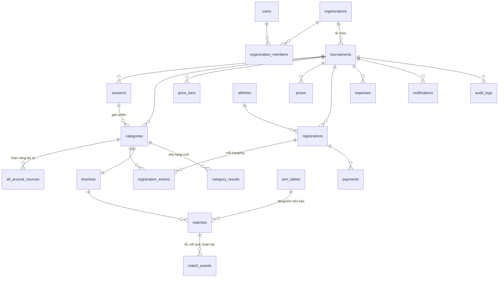

# Thiết kế database – VậtTay.vn (MVP)

Schema code: `src/db/schema.ts` (Drizzle ORM, PostgreSQL chuẩn).

## Nguyên tắc để chuyển Supabase → NestJS dễ dàng

1. Bảng `users` riêng, liên kết với nhà cung cấp đăng nhập qua `users.auth_subject` (không FK tới `auth.users`).
2. Không có logic nghiệp vụ trong SQL function / trigger / RLS. RLS chỉ là lớp chặn phụ.
3. Migration bằng `drizzle-kit`; Drizzle chạy được cả trong Next.js lẫn NestJS.
4. Realtime / Auth / Storage gọi qua `lib/realtime.ts`, `lib/auth.ts`, `lib/storage.ts`.
5. Ảnh lưu **key** (`cover_image_key`), không lưu URL đầy đủ → đổi Supabase Storage sang R2/S3 chỉ cần đổi cách dựng URL.

## Sơ đồ quan hệ

## Các quyết định chính

| Vấn đề | Cách làm |
|---|---|
| VĐV không cần tài khoản | `athletes` nhận diện theo (SĐT chuẩn hóa + tên bỏ dấu). `user_id` để trống, điền khi VĐV tạo tài khoản (giai đoạn sau). |
| Đăng ký nhiều hạng một lần | 1 `registrations` / VĐV / giải (giữ mã, tiền, check-in, cân) + nhiều `registration_entries` (mỗi hạng/tay). |
| Giá combo 2 tay, giá theo đợt | `price_tiers` có `single_hand_price`, `both_hands_price`, `valid_until`. Số tiền **chốt lúc đăng ký** vào `registrations.amount_due`, đổi giá sau không ảnh hưởng. |
| Sai năm sinh | Không chặn; `registrations.age_warning = true` để BTC lọc. |
| Giới hạn suất, chống vượt | Trong transaction: `SELECT … FOR UPDATE` dòng `tournaments`, đếm, tăng `registration_seq`, rồi insert. |
| Đối soát VietQR | Nội dung CK = `registrations.transfer_ref` (duy nhất). Webhook ghi `payments` (unique `provider + provider_txn_id` chống trùng). Không khớp → `registration_id = null`, `match_status = 'unmatched'` → hàng chờ ghép tay. Tiền mặt = `payments.method='cash'`. |
| Dung sai cân | `tournaments.weight_tolerance_kg`; đạt khi `weighed_kg <= weight_max_kg + tolerance`. Hệ thống chỉ ghi gợi ý vào `weigh_result`, BTC chốt. |
| Chuyển hạng | Entry cũ `status='moved'`, entry mới trỏ `moved_from_entry_id`. Ghi `audit_logs`. |
| Hạng Toàn năng | `categories.kind='all_around'` + `all_around_sources` + `all_around_max_place`. Khi mọi hạng nguồn có `category_results`, code tạo entry `auto_added=true`. |
| Bảng đấu loại đơn/kép | `matches` có `side` (winners/losers/grand_final) và con trỏ `next_match_id` / `loser_next_match_id`. Sinh toàn bộ cây khi bốc thăm; bye = `status='bye'`. |
| Kéo thả chỉnh bảng | Chỉ khi `brackets.status='draft'`: hoán đổi `red_entry_id`/`blue_entry_id` vòng 1. Khóa khi có trận xong. |
| Trọng tài bấm 2 lần / mất mạng | `match_events.client_event_id` unique + `matches.version` (optimistic lock). Hoàn tác = event `undo`, không xóa dữ liệu. Sẵn đường cho chế độ offline sau này. |
| Nhật ký kết quả (admin) | `audit_logs` với `before`/`after`. |
| Thông báo khi chưa có ZNS | `notifications.channels`: email, banner trên trang, văn bản để BTC copy vào nhóm Zalo. |
| Báo cáo thu chi | Thu = tổng `payments`; chi = `expenses`; hiển thị theo `tournaments.finance_visibility`. |

## Quy ước

- Tiền: `bigint` VND, không dùng số thực.
- Cân nặng: `numeric(5,2)` kg.
- Thời gian: `timestamptz`, hiển thị theo `tournaments.timezone`.
- SĐT lưu dạng E.164 (`+84912345678`); trang công khai luôn che.
- Xóa: giải dùng `status='cancelled'`, không xóa cứng dữ liệu có tiền/kết quả.

## Quyết định đã chốt

1. **Đăng ký thêm → cập nhật bản cũ.** Mỗi VĐV 1 `registrations`/giải. Thêm hạng (online hoặc tại sân) = thêm `registration_entries` với `fee` + `price_tier_id` của đợt giá **tại thời điểm thêm**:
   - Thêm tay thứ 2 → `fee = max(0, both_hands_price(đợt hiện tại) − tổng fee đã tính)` (được combo nếu đợt đó có combo; không bao giờ âm).
   - `amount_due = SUM(fee)` của entry đang active; `payment_status` tính lại (đang `paid` có thể về `partial`, VĐV quét QR mới cho phần còn thiếu, cùng `transfer_ref`).
   - Ghi `audit_logs` (`registration.add_entry`), vé QR giữ nguyên.
2. **Có hạng không phân giới tính**: `categories.gender='open'`. VĐV chỉ có `male`/`female` (check constraint).
3. **Loại kép có đấu lại chung kết**: `brackets.grand_final_reset=true`. Sinh sẵn 2 trận `side='grand_final'` (round 1, 2); nếu người nhánh thắng thắng trận 1 thì trận 2 → `status='skipped'`.
4. **Loại đơn có trận tranh hạng 3**: `brackets.third_place_match=true`, trận `side='third_place'` nhận 2 người thua bán kết (qua `loser_next_match_id`). Kết quả: 1 HCV, 1 HCB, 1 HCĐ.
